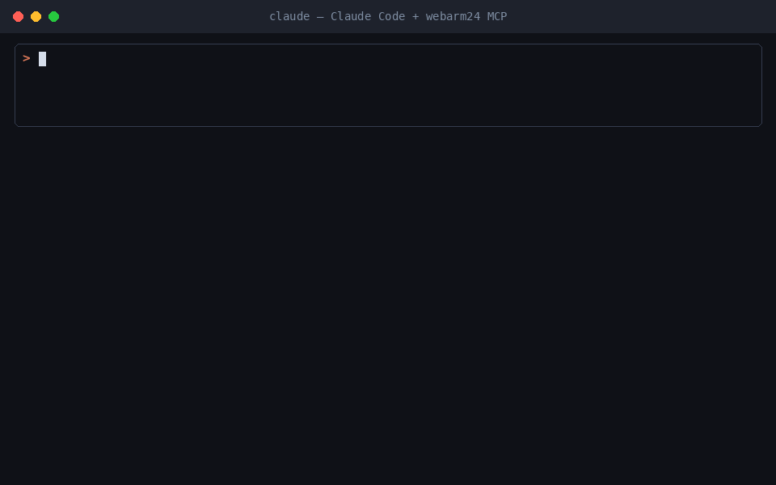

# WebArm24 MCP Server

**An AI automation platform (a modern n8n / Zapier / Make alternative) that your coding agent can drive end to end.**

Connect Claude Code, Cursor, Windsurf or any MCP client to [WebArm24](https://webarm24.online). Your agent can then
**build, schedule, run and debug real workflows** without you dragging nodes around a canvas.


*One sentence to Claude Code → a weekday 9am "Daily FX Report" workflow, created, run and emailed in 15.5s (a real run).*

- 🌐 Website: https://webarm24.online
- 🔌 MCP endpoint: `https://webarm24.online/mcp` (streamable HTTP, hosted, nothing to install)
- 📇 Official MCP Registry: [`online.webarm24/webarm24`](https://registry.modelcontextprotocol.io/v0/servers?search=online.webarm24)

## What your agent can do

| Area | Capabilities |
|---|---|
| **Workflows** | Create and edit multi-step pipelines that chain AI agent steps, HTTP requests, third-party MCP tools, JavaScript, Python, email, if/else branches and persistent storage |
| **Triggers** | Cron schedules, inbound webhooks, one-shot timestamps or manual runs |
| **AI builder** | Describe an automation in plain English and get a working pipeline back |
| **Run & debug** | Run pipelines, wait for results, read each step's output, test single steps and fix failures from chat |
| **Cloud browser** | For sites that have no API: navigate, click, fill, scroll, screenshot, extract text/HTML, reuse saved logins |
| **Storage** | Persistent JSON/text stores and files that are shared across runs |
| **Safety** | Full version history: restore any earlier version of a pipeline, including deleted ones |

60+ tools in total. One API key covers all of them.

## Quick start

1. Sign up at **https://webarm24.online**. New accounts get free credits.
2. Click the **MCP** button and create an API key (it starts with `wak_`).
3. Connect your client:

**Claude Code**
```bash
claude mcp add --transport http webarm24 https://webarm24.online/mcp \
  --header "Authorization: Bearer wak_YOUR_KEY"
```

**Cursor / Windsurf / other clients** (`mcp.json`)
```json
{
  "mcpServers": {
    "webarm24": {
      "type": "http",
      "url": "https://webarm24.online/mcp",
      "headers": { "Authorization": "Bearer wak_YOUR_KEY" }
    }
  }
}
```

4. Ask your agent something like:

> *"Use webarm24 to build a workflow that runs every weekday at 9am, pulls yesterday's orders from our API,
> summarizes them with AI and emails me the report. Run it once now."*

## Example workflows

- New form or webhook lead → enrich it → notify Slack/email → save it to storage
- Daily KPI report from any REST API, summarized by AI
- Weekly competitor-price or page-change monitoring, including sites without an API
- Content pipelines: generate → render → publish on a schedule
- Glue between MCP servers: call tools from other MCP servers as pipeline steps

### Example: gluing two MCP servers



*Every Monday, one pipeline calls the TidyData MCP server three times in parallel (US, UK and DE public holidays), merges the results, publishes them as a shared table with the rows.page MCP server, and emails the link. It's a real run that took 5.3s.*

## Pricing

Pay-as-you-go credits with no subscription. Creating, editing and reading pipelines is free. Runs, AI builder calls
and browser/email tool calls cost credits. Every new account gets free credits. See https://webarm24.online.

## Support

Report bugs and request features in [Issues](../../issues), or email timofeevld@mail.com.

---

This repository holds the public listing for the hosted WebArm24 MCP server. The service itself is closed source.
